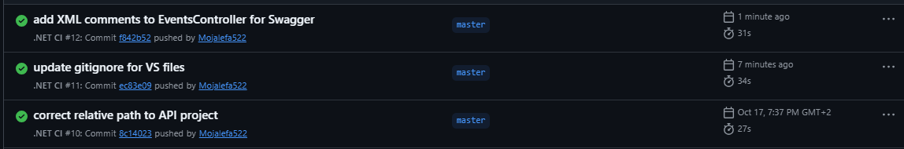

# RaceDayAPI

A Web API built with ASP.NET Core for managing race events, categories, enrolments and results. The system enforces role-based access, allowing Organisers to create events and Participants to enrol.

## User Roles

### Organiser
- Can create, update and delete events
- Can define categories such as the age groups and the distance for events
- Can view all enrolments for their events
- Can enter finish times and positions for participants

### Participant
- View available events and categories
- Enrol in an event by selecting a category
- View their own results

## Setup Instructions

1. Clone the repository:
   ```bash
   git clone https://github.com/Mojalefa522/RaceDayAPI.git

## CI/CD

GitHub Actions builds and runs tests on every push.



## YouTube Video Link
https://youtu.be/R7yk_NVO6jc
